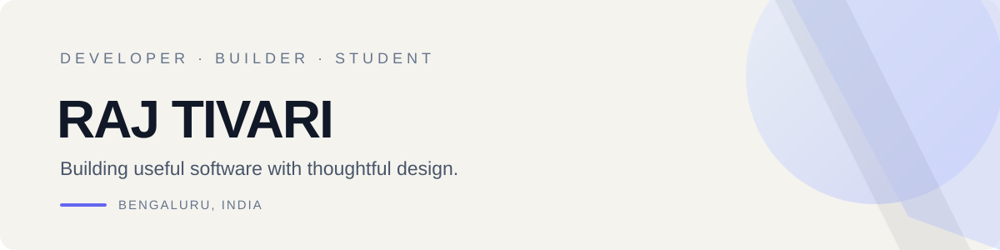

# 👋 Hey, I'm Raj Tivari

**💻 CSE Student &nbsp;·&nbsp; 🛠️ Software Developer &nbsp;·&nbsp; ✨ Builder**

I build practical web apps and interactive experiences, focusing on useful developer tools, thoughtful interfaces, and learning by shipping real projects.

---

## 🧑‍💻 About me

- 🎓 Computer Science Engineering student in Bengaluru, India.
- 🧩 Interested in frontend development, developer productivity, and interactive experiences.
- 🚀 Learning by building and improving real projects.
- 🎯 Current focus: better UI, maintainable code, and useful tools.

## 🚀 Featured projects

<table>
<tr>
<td width="50%" valign="top">

### 🗂️ [DevVault](https://github.com/rajtivari/DevVault)

A local-first developer knowledge workspace for notes, reusable code snippets, collections, a knowledge graph, and everyday developer utilities.

[🌐 Live app](https://devvault.rajtivari.qd.je/) · [💻 Source code](https://github.com/rajtivari/DevVault)

**Built with:** React · TypeScript · Vite

> 🔒 Data stays in the browser. Account-based cloud sync is not currently available.

</td>
<td width="50%" valign="top">

### 💎 [Crystal Portfolio](https://github.com/rajtivari/rajtivari.github.io)

A personal portfolio exploring prismatic visuals, interactive 3D, motion, editorial typography, and project storytelling.

[🌐 Visit portfolio](https://rajtivari.github.io/) · [💻 Source code](https://github.com/rajtivari/rajtivari.github.io)

**Built with:** HTML · CSS · JavaScript · Three.js / WebGL

</td>
</tr>
<tr>
<td width="50%" valign="top">

### 🎮 [ApexNova](https://github.com/rajtivari/ApexNova)

An eSports tournament operations project for Free Fire and BGMI, with role-based dashboard workflows and a planned API layer.

[💻 Explore repository](https://github.com/rajtivari/ApexNova)

**Status:** In development. Payment, KYC, and game-room workflows are mock-only.

</td>
<td width="50%" valign="top">

### 🧪 More experiments

I keep exploring frontend engineering, interface design, developer tools, and interactive experiences.

[📚 Browse all repositories](https://github.com/rajtivari?tab=repositories)

</td>
</tr>
</table>

## 🧰 Technology

## 📊 GitHub activity

## 🧭 Journey

| Focus | What I'm working toward |
|:--|:--|
| 🖥️ Frontend | Responsive interfaces, accessible UI, and polished interactions |
| 🧰 Developer tools | Better ways to organize knowledge and reuse code |
| 🧊 Creative coding | Exploring animation and interactive 3D |
| 📈 Engineering habits | Clear documentation, testing, and maintainable projects |

## 🤝 Let's connect

✨ Learning by building. Improving one project at a time.

